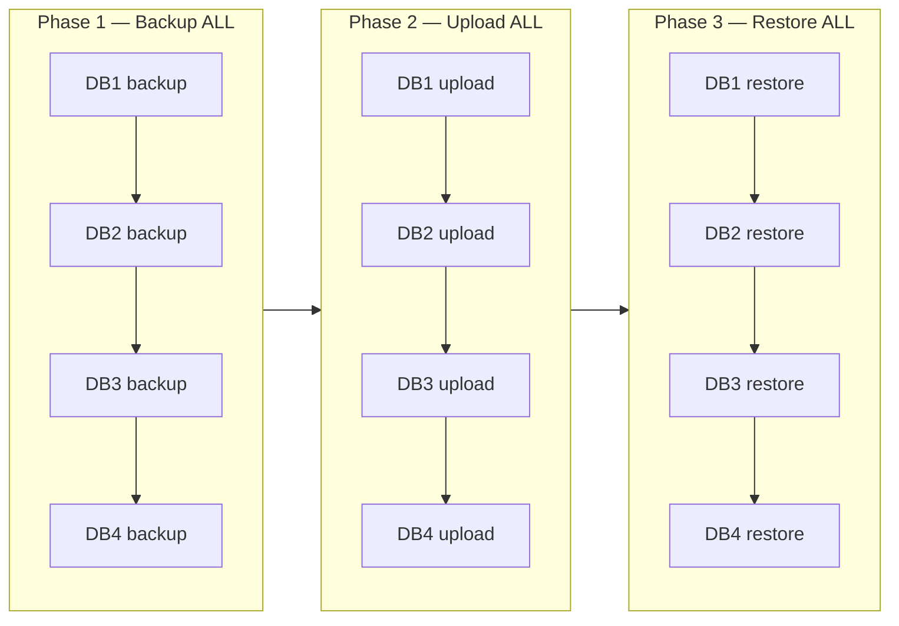
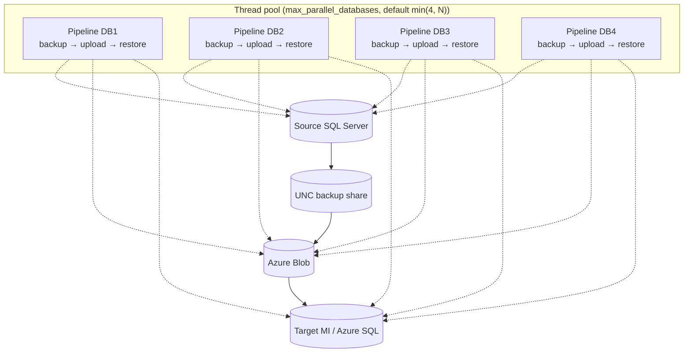
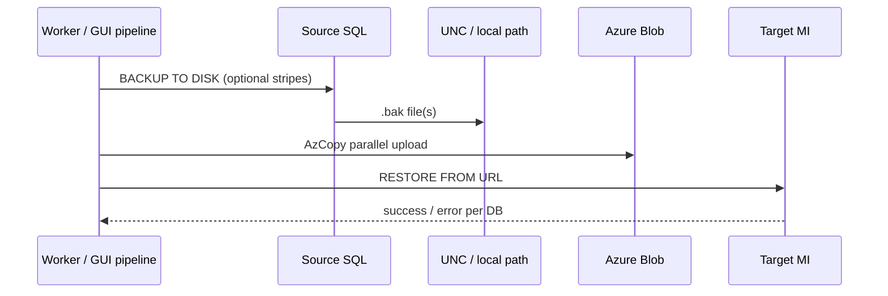
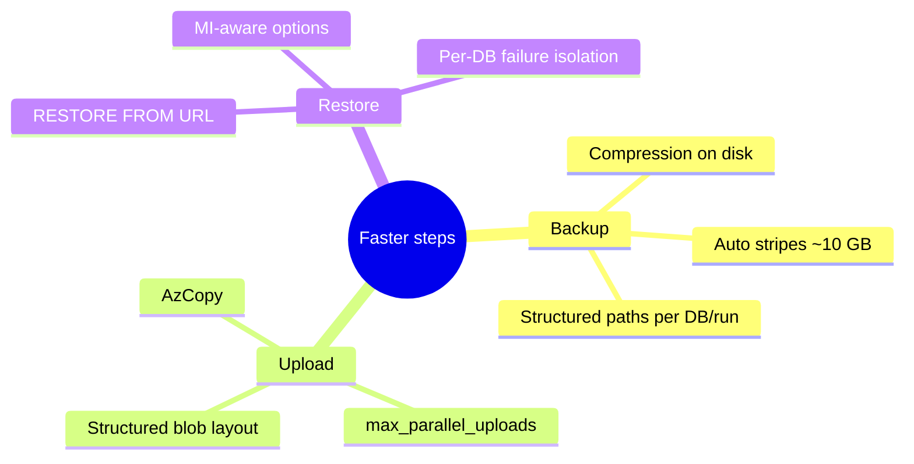
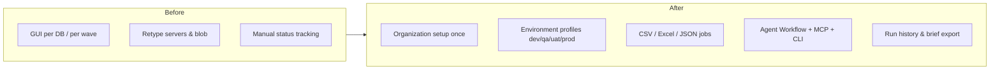
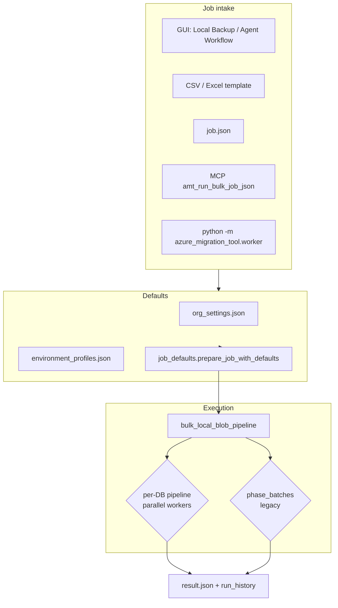
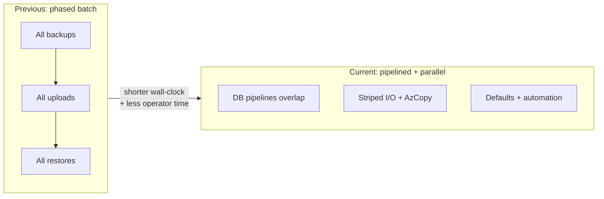

# Migration time: previous approach vs current pipeline

This document explains **why bulk SQL → Azure Blob → MI restore runs finish sooner** with the current Azure Migration Tool design, and **which changes** produced that gain. It focuses on the **Local Backup (multiple databases)** flow (GUI, CLI worker, and MCP).

Related references:

- [Headless worker](worker/HEADLESS_WORKER.md)
- [Job payload & defaults](worker/JOB_PAYLOAD.md)
- Implementation: `azure_migration_tool/src/orchestration/bulk_local_blob_pipeline.py`

---

## 1. Executive summary

| Area | Previous approach | Current approach | Effect on wall-clock time |
|------|-------------------|------------------|---------------------------|
| **Orchestration** | Three **global phases**: backup all DBs → upload all → restore all | **Per-database pipeline**: each DB runs backup → upload → restore as soon as its backup finishes | Large DBs no longer block small DBs from reaching restore; overlap across DBs |
| **Parallelism** | Mostly sequential per phase; limited overlap | Up to **4 databases in parallel** by default (`max_parallel_databases`); parallel **file** uploads per DB | Shorter total duration for multi-DB batches |
| **I/O** | Single large `.bak` for big DBs | **Auto striping** (~10 GB per stripe) for backup, upload, and restore | Better use of disk, network, and blob block parallelism |
| **Operator time** | Repeat server, blob, UNC, and MI settings in the GUI for every run | **Organization setup** + **environment profiles** merged into jobs; **CSV/Excel** and **JSON** bulk intake | Less manual work; fewer mistakes and reruns |
| **Automation** | GUI-only clicks | **Worker CLI**, **MCP**, **playbooks**, **run history** | Runs start faster; less waiting on humans between waves |

**Important:** Exact minutes saved depend on database size, network, and MI capacity. The diagrams below show **structure** of the improvement, not guaranteed SLA numbers.

---

## 2. Previous approach: phased batch (all DBs per step)

In the **phase-batch** model, the tool finishes **every** backup before **any** upload starts, and finishes **every** upload before **any** restore starts.



### Timeline (conceptual)

For four databases where DB1 is small and DB4 is large:

```mermaid
gantt
    title Phased batch — DB1 waits on DB4
    dateFormat X
    axisFormat %s
    section DB1
    backup   :a1, 0, 2
    idle     :crit, 2, 10
    upload   :a2, 10, 12
    idle     :crit, 12, 18
    restore  :a3, 18, 20
    section DB4
    backup   :b1, 2, 10
    upload   :b2, 10, 14
    restore  :b3, 18, 22
```



**Pain points:**

- **Head-of-line blocking:** A fast database cannot upload or restore until the slowest backup in the wave completes.
- **Under-used windows:** Blob and MI may sit idle while backups still run on other databases.
- **Manual orchestration:** Multi-DB migrations often meant repeating the same wizard steps or running one DB at a time.

You can still force phased behavior by setting `phase_batches` (or `pipeline.phase_batches`) on a job, which disables per-database parallelism.

---

## 3. Current approach: per-database pipeline with parallel workers

Each database moves through **its own** backup → upload → restore chain. Multiple databases run **at the same time** (default cap: **4** parallel pipelines).



### Same four databases — overlapped work

```mermaid
gantt
    title Per-DB pipeline — DB1 restore starts early
    dateFormat X
    axisFormat %s
    section DB1
    backup   :a1, 0, 2
    upload   :a2, 2, 4
    restore  :a3, 4, 6
    section DB2
    backup   :b1, 0, 3
    upload   :b2, 3, 6
    restore  :b3, 6, 8
    section DB4
    backup   :d1, 0, 8
    upload   :d2, 8, 12
    restore  :d3, 12, 16
```



DB1 can be **fully on the target** while DB4 is still backing up — that is the main wall-clock win for mixed-size batches.

### Single-database sequence (unchanged logic, clearer progress)



Progress is tracked **per database and per step** (backup / upload / restore) in the GUI status panel and in worker JSON results.

---

## 4. Additional throughput improvements (within each step)

These apply in **both** phased and pipelined modes but matter most when many DBs run in parallel.



| Mechanism | Where | Why it saves time |
|-----------|--------|-------------------|
| **Backup striping** | `stripe_utils.py`, backup options `stripes: auto` | Splits large DBs into parallel I/O streams (~10 GB per stripe, capped at 64) |
| **Parallel blob upload** | `upload_existing_bak_files_parallel` | Multiple `.bak` stripes upload concurrently |
| **Parallel databases** | `_execute_database_pipelines` in `bulk_local_blob_pipeline.py` | Default `max_parallel_databases` ≈ 4 (configurable; `max` / `all` = one worker per DB) |
| **Skip completed work** | `steps` + `backup_runs` in job JSON | Upload/restore only when backups already exist — no repeated backup window |

---

## 5. Less calendar time for the team (not just SQL wall-clock)

Even when SQL and network are the bottleneck, these changes **shorten the migration project**:



| Capability | What it does |
|------------|----------------|
| **Organization setup wizard** | Default UNC, blob prefix, project folder — jobs can omit empty paths |
| **Environment resolver** | Infers `qa` / `uat` / `prod` from DB name (`db22q`), hostname, or explicit `environment` |
| **Job defaults merge** | Payload overrides profiles; `amt_prepare_job_payload` previews effective job |
| **CSV / Excel import** | Many databases and jobs from one spreadsheet |
| **Worker + MCP** | CI, Cursor agents, and scripts run the same pipeline as the GUI |
| **Playbooks** | Declarative resolve → prepare → run for repeatable pilots |
| **Run history** | AgentOps dashboard — less time spent reconstructing what ran |

---

## 6. End-to-end architecture today



---

## 7. How to tune parallelism

In job JSON (or merged effective job):

```json
{
  "pipeline": {
    "max_parallel_databases": 4
  }
}
```

| Value | Behavior |
|-------|----------|
| **Omitted** | `min(4, number of databases)` |
| **Integer N** | Up to N databases in parallel |
| **`max` / `all`** | One pipeline per database |
| **`phase_batches`: true** | Legacy: backup all → upload all → restore all (no per-DB overlap) |

Also set blob `max_parallel_uploads` for wide stripe sets (see blob job settings and organization blob dialog).

---

## 8. Measuring improvement on your environment

1. Run the **same database list** twice on a test window: once with `phase_batches: true`, once with default per-DB pipeline (or compare an older tool build vs current).
2. Compare **`started_utc` / `ended_utc`** in `worker_jobs/*_result.json` or **Tools → AgentOps** run history.
3. Watch **per-DB** progress: time from first restore complete to last restore complete — pipelining usually shrinks this gap when sizes vary.

---

## 9. Summary diagram



**Bottom line:** Migration **elapsed time** drops because work **overlaps across databases** and **within large backups**, and migration **project time** drops because **defaults, bulk jobs, and agents** replace repeated manual GUI setup.
